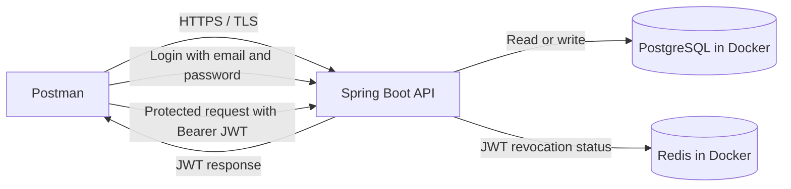

# Local HTTPS and API testing

Use this as a short reminder for running and testing this sample on your own
computer. It is a learning project, not a production banking application.

## 1. What we added and why

- **HTTPS/TLS:** encrypts network traffic between Postman and the app.
- **JWT:** identifies the signed-in user on protected API requests.
- **Password hashing:** stores a password hash instead of a readable password.
- **AES-GCM encryption:** encrypts selected sensitive database fields.
- **Redis token revocation:** lets logout revoke a JWT before its normal expiry.
- **Security headers:** adds browser protections such as HSTS and frame denial.

### Request flow



- Every API request uses `https://localhost:8443`.
- TLS protects the connection; the JWT proves who the user is.
- Use a fake password and fake account data for local tests.

## 2. Why there are two `.p12` files

- `certs/server-keystore.p12`
  - Contains the server's TLS certificate and private key.
  - The app presents its certificate when Postman connects using HTTPS.
  - Postman does not need this keystore uploaded for local testing.
- `certs/jwt-signing-keystore.p12`
  - Contains a separate private key used by the app to sign JWTs.
  - The app checks JWT signatures using the matching public key.
- These keystores have different jobs; do not reuse one for the other.
- Keep both `.p12` files and all passwords private; never commit them.
- `.env` and `certs/` are local setup files and are ignored by Git.

### Other required secret

- `AES_DB_KEY` is a secret value, not a `.p12` file.
- It encrypts selected database fields such as settlement account number.
- Keep using the same key for the same database.
- Changing it without a data migration can make existing encrypted values
  unreadable.

## 3. Files and settings by environment

| Environment | What you provide |
|---|---|
| Local Docker testing | App source/build files; a local `.env` or shell environment variables; a self-signed `certs/server-keystore.p12`; a separate `certs/jwt-signing-keystore.p12`; Docker Compose services and volumes. |
| Shared development | A built app/container image; environment-specific database, Redis, OAuth, and AES secrets; a TLS certificate/keystore trusted by the development clients; a separate persistent JWT signing key. Keep secrets in the team's secret manager, not in Git. |
| Production | A built, reviewed app/container image; a CA-issued TLS certificate and private key provided securely; a separate stable JWT signing key; `AES_DB_KEY`; database, Redis, and OAuth credentials; managed/persistent PostgreSQL and Redis. Inject secrets through the platform's secret manager. |

- `.env` is convenient for local Compose runs; it is not a production
  deployment requirement.
- The local self-signed `localhost` certificate is only for local testing.
- Do not skip TLS or required keys in development/production. Replace local
  files with secure environment-specific secrets and certificates.
- With the current app configuration, provide the server and JWT keystores at
  the configured paths (or update the configuration to use your platform's
  secure mounts). Never package private keys into a public image or repository.

## 4. Create secrets and start the app

1. Install/use Java 17, Docker Desktop, and `keytool`.
2. Open PowerShell in the repository folder and generate two different
   keystores:

   ```powershell
   New-Item -ItemType Directory -Force certs
   keytool -genkeypair -alias server -keyalg RSA -keysize 3072 -storetype PKCS12 `
     -keystore certs\server-keystore.p12 -validity 365 `
     -dname "CN=localhost" -ext "SAN=dns:localhost,ip:127.0.0.1"
   keytool -genkeypair -alias jwt-signing -keyalg RSA -keysize 3072 -storetype PKCS12 `
     -keystore certs\jwt-signing-keystore.p12 -validity 3650 `
     -dname "CN=bank-app-jwt-signing"
   ```

   - `keytool` asks you to create passwords; do not use example passwords.
   - For these PKCS12 files, press Enter at the private-key password prompt to
     reuse the keystore password.
   - Set `JWT_KEY_PASSWORD` to the same value as
     `JWT_KEY_STORE_PASSWORD`.
   - These commands create a self-signed localhost certificate for testing;
     do not use it as the public certificate in production.
3. Keep local configuration in a `.env` file in the repository root, or set
   the same variables in the PowerShell process that runs Compose as shown in
   [TLS.md](TLS.md). Compose reads `.env` automatically. Required values are:

   - `SSL_PASSWORD`
   - `JWT_KEY_STORE_PASSWORD`
   - `JWT_KEY_PASSWORD`
   - `DB_PASSWORD`
   - `REDIS_PASSWORD`
   - `GITHUB_CLIENT_ID`
   - `GITHUB_CLIENT_SECRET`
   - `AES_DB_KEY` (16, 24, or 32 UTF-8 bytes)

   Optional values include `DB_USERNAME` (defaults to `postgres`) and
   `JWT_KEY_ALIAS` (defaults to `jwt-signing`).

   Local `.env` layout (fill in your own values; do not commit this file):

   ```text
   SSL_PASSWORD=
   JWT_KEY_STORE_PASSWORD=
   JWT_KEY_PASSWORD=
   DB_PASSWORD=
   REDIS_PASSWORD=
   GITHUB_CLIENT_ID=
   GITHUB_CLIENT_SECRET=
   AES_DB_KEY=
   ```

   `.env` is ignored by Git because it contains passwords, OAuth credentials,
   and encryption keys. Do not commit the real `.env` file or put real values
   in documentation.
4. Generate a random AES key for local use. This PowerShell command prints 32
   ASCII characters; put its result in `AES_DB_KEY` in `.env` and keep it safe:

   ```powershell
   $rng = [System.Security.Cryptography.RandomNumberGenerator]::Create()
   $bytes = New-Object byte[] 24
   $rng.GetBytes($bytes)
   [Convert]::ToBase64String($bytes)
   $rng.Dispose()
   ```

   Keep the same key for the same database.
5. In Windows CMD, change to the repository folder and run:

   ```cmd
   mvnw.cmd package
   docker compose up --build
   ```

6. Leave that window running. Check services from a second CMD window:

   ```cmd
   docker compose ps
   ```

- App container: `bank_api`
- Database container: `bank_postgres`
- Redis container: `bank_redis`
- HTTPS port: `8443`

### Local certificate note

- The local server certificate is self-signed, so Postman may show a
  certificate error.
- Use **Settings → General → SSL certificate verification → Off** only if
  needed for local testing.
- This keeps TLS encryption but skips checking that the certificate identity
  is trusted. Do not disable verification in production.
- Do not use HTTP, add an SSL field to the request, or upload the server's
  private keystore to Postman.
- For a real deployment, use a CA-issued certificate and keep verification on.
- This app uses server-authenticated TLS, not mutual TLS (mTLS).
- The local `.env` file and self-signed localhost certificate are not
  production deployment files. Do not copy them as-is.
- Production still needs TLS, JWT signing material, database/Redis/OAuth
  credentials, and `AES_DB_KEY`. Supply them through a secret manager or
  protected deployment environment; use a CA-issued TLS certificate.

## 5. Test the APIs in Postman

For JSON requests, choose **Body → raw → JSON**. Use
`https://localhost:8443` for every endpoint.

- Quick HTTPS check from Windows CMD:

  ```cmd
  curl.exe -k -i https://localhost:8443/api/v1/inventory/public/products
  ```

- `-k` skips certificate verification for this local self-signed certificate;
  the connection still uses TLS. Use this only for local testing.

### A. List products

- Method: `GET`
- URL: `https://localhost:8443/api/v1/inventory/public/products`
- Authorization: none
- Body: none
- Expected: `200 OK`, with products as JSON; `[]` means no product has stock
  greater than zero.

### B. Register a customer

- Method: `POST`
- URL: `https://localhost:8443/api/v1/auth/register`
- Authorization: none
- Body:

  ```json
  {
    "email": "demo@example.com",
    "name": "Demo User",
    "password": "DemoPassword123"
  }
  ```

- Expected: `201 Created` and `User created successfully`.
- Password must be at least 12 characters.
- Email must be valid and unique; use a different test email if already used.
- New users receive `ROLE_CUSTOMER`.

### C. Log in and copy the JWT

- Method: `POST`
- URL: `https://localhost:8443/api/v1/auth/login`
- Authorization: none
- Body:

  ```json
  {
    "email": "demo@example.com",
    "password": "DemoPassword123"
  }
  ```

- Expected: `200 OK` with a JWT string.
- Copy the returned token.

### D. Create an order

- Method: `POST`
- URL: `https://localhost:8443/api/v1/orders/create`
- Authorization tab: choose **Bearer Token** and paste the JWT.
- Body: use a product ID from step A.

  ```json
  {
    "productId": 1,
    "quantity": 1,
    "settlementAccountNumber": "TEST-ACCOUNT-001"
  }
  ```

- Expected: `201 Created` with the order.
- Use only a fake settlement account value.

### E. List your orders

- Method: `GET`
- URL: `https://localhost:8443/api/v1/orders/my-orders`
- Authorization tab: **Bearer Token**, same JWT.
- Body: none
- Expected: `200 OK` with your orders.

### F. Log out

- Method: `POST`
- URL: `https://localhost:8443/api/v1/auth/logout`
- Authorization tab: **Bearer Token**, same JWT.
- Body: none
- Expected: `200 OK`; the token is revoked until its expiration.
- Try step E again with the revoked JWT; it should no longer be accepted.

### Admin-only API

- Method: `POST`
- URL: `https://localhost:8443/api/v1/inventory/admin/products`
- Requires a JWT with `ROLE_ADMIN`.
- A user created through registration has `ROLE_CUSTOMER`, not admin.

## 6. Where the database lives

- Database name: `bank_inventory`
- Docker Compose service: `postgres`
- App-to-database address inside Docker: `postgres:5432`
- Host/pgAdmin address: `localhost:5432`
- PostgreSQL container: `bank_postgres`
- Docker storage volume: `postgres_data`
- The volume persists database data; the data is not stored as normal files in
  the repository.
- A database with the same name on another PostgreSQL server is a different
  database. Check both host and port.

### View tables and rows in Docker Desktop

1. Open **Containers → bank_postgres → Exec**.
2. Start the PostgreSQL command line:

   ```text
   psql -U postgres -d bank_inventory
   ```

3. At the `bank_inventory=#` prompt, list tables and view safe fields:

   ```sql
   \dt public.*
   SELECT id, sku, available_stock, retail_price FROM public.product ORDER BY id;
   SELECT id, email, name, roles FROM public.users ORDER BY id;
   SELECT id, order_number, customer_username, product_id, quantity, total_amount, status
   FROM public.orders
   ORDER BY id;
   ```

4. Exit with `\q`.

- From Windows CMD instead, the same database can be opened with:

  ```cmd
  docker compose exec postgres psql -U postgres -d bank_inventory
  ```

- Java entity `UserInfo` maps to the PostgreSQL table `public.users`.
- Never query or share the `password` column; it contains password hashes.
- Settlement account and wholesale cost are sensitive encrypted fields.

### View the same database in pgAdmin

- Register/connect a server with host `localhost`, port `5432`, database
  `bank_inventory`, and the username/password configured for Compose.
- Expand **Databases → bank_inventory → Schemas → public → Tables**.
- Right-click a table and choose **View/Edit Data → All Rows**.
- To list only application tables in Query Tool:

  ```sql
  SELECT table_schema, table_name
  FROM information_schema.tables
  WHERE table_schema = 'public'
    AND table_type = 'BASE TABLE'
  ORDER BY table_name;
  ```

- To check the active connection:

  ```sql
  SELECT current_database(), inet_server_addr(), inet_server_port();
  ```

- If you edit table data in pgAdmin, save/commit the change (for example, use
  the Save Data Changes button in the grid). Confirm the connection targets
  host `localhost`, port `5432`, and `bank_inventory`.

## 7. Demo product data

If the public products endpoint returns `[]`, first check:

```sql
SELECT id, sku, available_stock FROM public.product ORDER BY id;
```

For a local demo database only, add sample products if those SKUs do not
already exist:

```sql
INSERT INTO public.product (sku, available_stock, retail_price, wholesale_cost)
VALUES
  ('PROD-001', 50, 25.99, NULL),
  ('DEMO-001', 10, 9.99, NULL);
```

- The database generates IDs automatically; do not include an `id` value.
- SKU must be unique; do not insert the same sample rows twice.
- The product endpoint returns only rows where `available_stock > 0`.

## 8. Common issues

- **Postman certificate error:** confirm the URL starts with `https://`; for
  local testing only, turn off SSL certificate verification in Postman.
- **Products response is `[]`:** check the `product` rows in the Docker
  database and ensure stock is greater than zero.
- **`public.users` does not exist:** check `\dt public.*` inside
  `bank_postgres`; verify the app started and the registration request
  completed successfully.
- **Registration says email already exists:** log in with that user or choose
  a different test email.
- **Protected API returns `401` or `403`:** log in, send the JWT as a Bearer
  token, and confirm the user's role permits that endpoint.
- **Encrypted values fail after changing `AES_DB_KEY`:** restore the original
  key for that database; key rotation needs a data migration.
- **Byte Buddy startup error:** in the local test history, Docker reported a
  missing `net.bytebuddy` runtime class. The dependency is set to runtime scope
  in this repository to fix that startup issue.

## 9. Main code files

- HTTPS and database settings: `src/main/resources/application.yml`
- Docker services, ports, secret mounts, and database volume:
  `docker-compose.yml`
- Endpoint authorization and security headers:
  `src/main/java/com/ali/security/config/SecurityConfig.java`
- Register/login: `src/main/java/com/ali/security/controller/AuthController.java`
- Logout/token revocation:
  `src/main/java/com/ali/security/controller/LogoutController.java`
- Products:
  `src/main/java/com/ali/security/controller/ProductController.java`
- Orders:
  `src/main/java/com/ali/security/controller/OrderController.java`
- User table mapping:
  `src/main/java/com/ali/security/entity/UserInfo.java`
- Sensitive database encryption:
  `src/main/java/com/ali/security/service/SensitiveDataConverter.java`
- Keystore creation and required secrets: [TLS.md](TLS.md)
